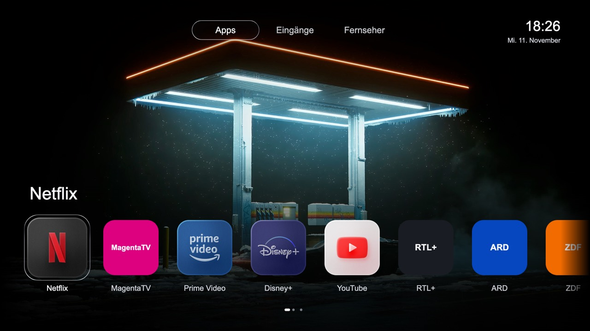

# Hisense VIDAA: eigener Homescreen statt Werbung

**Sprache / Language: Deutsch · [English](README.md)**

[Agent-Einstieg](AGENT-START.md) · [Masterprompt](MASTERPROMPT.md) · [Einfache Anleitung](START-HERE.md) · [Simulation](SIMULATION.md)

Dieses Projekt erklärt Coding Agents, wie sie auf einem **kompatiblen Hisense
VIDAA-Fernseher** eine eigene native Startseite mit einem App-Dock einrichten.
Dazu gehören langes OK zum Verschieben/Ausblenden, Eingänge, TV-Einstellungen,
App Store und eigene animierte Hintergründe.



Die Vorschau zeigt das Referenzdesign. Die abgebildeten privaten Icons und das
Hintergrundvideo werden nicht als Dateien mitgeliefert. Standardmäßig werden
lokale TV-App-Icons oder Textkacheln genutzt.

## Einfach Codex geben (empfohlen)

```text
Use this: https://github.com/nineodernein/hisense-vidaa-clean-home
```

Der Einstieg enthält ein konkretes Ziel und einen ausführbaren Ablauf.
[Unsere funktionierenden Wege und die damaligen Fehler](WORKED-EXAMPLE.md)
sind dokumentiert. Bei anderen Geräten folgt der Agent dem
[Portierungsablauf](PORTING.md): eigene Originaldateien, passende SDK-Schnittstelle,
private Sicherung und separater Test. Ein anderes Modell beendet nicht einfach
die Recherche. Eine universelle Freigabe für jede Firmware ist das weiterhin nicht.
Die [gezielte Zugangsuntersuchung](ACCESS-RESEARCH.md) ergänzt konkrete
Leseaufrufe, getrennte HiUtils-/Fetcher-Wege und dokumentierte Fehldiagnosen.
Der Agent hält Ergebnisse fest und verfolgt bei einer gesperrten Schnittstelle
den nächsten durch Quellen begründeten Ansatz. Community-Meldungen werden
getrennt von bestätigten Installationen geführt.

**`websdk/Appinfo.json` fehlt?** Die
[Anleitung zur Suche nach dem nativen Home](ACCESS-RESEARCH.md#discover-native-home-when-appinfojson-is-missing)
beschreibt das operationui-Paket und seine `current`-/CHA-/CHB-Pfade. Beim
[55U7NQ mit D.Q0516](COMPATIBILITY.md#community-case-55u7nq) wurden erfolgreiche
Dateilesungen gemeldet; Home-Pfad und native Kompatibilität sind noch unbestätigt.

**Für dieses Projekt empfiehlt der Maintainer Codex auf dem eigenen Computer.**
Der Maintainer hat die ursprüngliche Einrichtung mit mehreren Modellen
entwickelt, darunter GPT-6.0 (Astra), und berichtet von erfolgreicher
Unterstützung bei diesem Ablauf. Auch der bereits dokumentierte 50E6NT-Besitzer
meldet eine erfolgreiche Einrichtung nach dem Wechsel zu Codex. Die Empfehlung
beruht auf eigener Erfahrung und Community-Berichten; sie ist kein kontrollierter
Vergleich und keine Erfolgsgarantie für jede Modellversion oder jeden Fernseher.
Die [Agent-Empfehlung](AGENT-TROUBLESHOOTING.md#recommended-coding-agent-codex)
erläutert die Grundlage.

Gib Codex den Repo-Link mit dem Auftrag, es auf deinem eigenen TV einzurichten.
Du kannst **Deutsch oder Englisch** wählen; der Agent soll in deiner gewählten
Sprache weiterarbeiten.
Andere geeignete lokale Coding Agents können denselben Ablauf verwenden.
Der Agent soll zuerst selbst die lokalen Prüfungen starten. Falls er den Link
nur zusammenfasst, kopiere diesen kurzen Auftrag:

> Richte https://github.com/nineodernein/hisense-vidaa-clean-home für meinen eigenen TV ein. Folge AGENT-START.md und MASTERPROMPT.md und starte jetzt die Offline-Prüfungen. Untersuche fehlende Zugänge nach ACCESS-RESEARCH.md und verfolge nach einem fehlgeschlagenen Weg die nächsten durch Quellen begründeten Ansätze. Nutze vorhandene Angaben und Freigaben weiter. Sichere Originale privat und prüfe den Rückweg vor nativen Änderungen. Ändere keine anderen Geräte.

Der Agent bekommt Quellcode und konkrete Prüfschritte. Er muss nicht noch einmal
das ganze Projekt erfinden. Ein normaler Chat ohne Zugriff auf deinen Computer
und dein Netzwerk kann den Fernseher trotzdem nicht selbst ändern.

Der ausführbare Start mit vorhandenem Python 3.10+ und Node 18+ lautet:

```sh
python3 agent.py start --json
```

Er testet die Quellen und erstellt private, leere Vorlagen. `prepare` prüft später
die tatsächlichen Geräteangaben und Originaldateien, sichert sie erneut und baut
ein privates Paket. Diese Befehle nehmen keinen Kontakt zum TV auf. Die passende
Wartungsverbindung und eine geprüfte Installation bleiben geräteabhängig.
Eine bestandene Simulation ersetzt keinen Hardwaretest.

## Neue Erkenntnisse: erfolgreicher Lesezugriff und mögliche Home-Pfade

Der [Bericht zum 55U7NQ / 55U75LEVS](COMPATIBILITY.md#community-case-55u7nq)
mit MTK9618 / `V0000.09.60D.Q0516` liefert einen hilfreichen bestätigten Schritt
aus der Untersuchung des Besitzers: HiUtils konnte
`pkgs/tv.vidaa.jsservice.basic/CHA/services/hiutils/fileOperation.js` lesen.
Laut dessen Quelltextprüfung ordnet der Handler Modus 6 dem Verzeichnis `/APPS/`
zu. Dieser funktionierende Lesezugriff ist ein Ausgangspunkt für die weitere
Paketsuche, obwohl `websdk/Appinfo.json` mit ENOENT antwortete. ENOENT bezeichnet
diesen fehlenden Pfad und belegt keine allgemeine Lesesperre.

Verwandte Upstream-Berichte nennen das operationui-Paket als Ansatz für die
Home-Suche. Wenn die eigene `/APPS/`-Zuordnung bestätigt ist, lautet der erste
Pfadkandidat:

```text
/APPS/pkgs/tv.vidaa.app.operationui/current/apps/launcher/js/app.js
```

`current` muss für jedes Paket getrennt aufgelöst werden: Dokumentierte Geräte
nutzen CHA oder CHB. CHA beim Basisdienst bestätigt nicht den aktiven Home-Kanal.
Die [englische Anleitung zur Pfadsuche](ACCESS-RESEARCH.md#discover-native-home-when-appinfojson-is-missing)
verlinkt die festgehaltenen Upstream-Quellen und erklärt Paketmetadaten,
Engine-Anbindung und die noch nötigen Originaldatei- und Wiederherstellungsprüfungen.
Dieser Launcher-Pfad ist auf D.Q0516 noch nicht bestätigt; der erfolgreiche
Dienst-Dateizugriff ist ein Fortschritt auf dem Weg zur Portierung.

## Warum die vorhandene native Home-Engine weiterverwenden?

Bei der Referenzeinrichtung wurde temporärer, autorisierter Root-Wartungszugang
für die Installation genutzt. Das Dock ersetzt die native `/Launcher`-Komponente
und erhält die Hersteller-Engine, Modulregistrierung, Anbindung installierter
Apps, Eingänge und Einstellungen. Am Referenzgerät kehrt die physische Home-Taste
direkt über diese vorhandene Engine zurück. Ein eigenes separates Verzeichnis
müsste ebenfalls in deren Startablauf und Home-Tasten-Verarbeitung eingebunden
werden. Details stehen im [erfolgreichen Vorgehen](WORKED-EXAMPLE.md).

## Weniger Handarbeit bei der Einrichtung

Die [englische Anleitung für Fernbedienung und Browser](REMOTE-AND-BROWSER.md)
beschreibt die normale TV-Kopplung, Navigation durch den Agenten und temporäre
Diagnoseseiten mit direkter Ergebnisübertragung auf den eigenen Rechner.
Die spätere Startseite bleibt nativ. Ein universeller Fernbedienungs-Client oder
Kopplungsdaten werden nicht mitgeliefert.
Wenn Claude Code oder ein anderer Agent stoppt, hilft die
[Anleitung zur gezielten Fehlerklärung](AGENT-TROUBLESHOOTING.md), den tatsächlichen
Grund einzugrenzen und erlaubte Arbeit fortzusetzen. Sicherheitsregeln oder
Werkzeugbeschränkungen werden damit nicht umgangen.

## Was funktioniert?

Am Referenzgerät wurden native Home-Rückkehr, App-Start, App-Favoriten bearbeiten,
Eingänge sowie ein lokales Video in Schleife und der manuelle Video-Bildschirmschoner
bestätigt. Das ist ein **nativer Umbau**, keine Browser-Umleitung.

Der veröffentlichte, verallgemeinerte Build ist offline geprüft, aber nicht als
neue Version auf dem Referenz-TV installiert. Die gemeinsame Medienauswahl ist
vorbereitet und offline getestet. Ein automatischer Regenvideo-Bildschirmschoner
bei pausiertem Netflix ist **nicht fertig**. Der reale Zehn-Minuten-Test auf Home
steht ebenfalls aus.

## Kann ich animierte Hintergrundbilder hinzufügen?

Ja. Eigene Videos werden lokal zu stummen H.264-MP4-Dateien mit 1080p/24 fps
aufbereitet. Ein JPG dient als Lade-/Fehlerfallback. Überblendung und eine kurze
zyklische Fortsetzung verringern sichtbare Sprünge beim Wiederholen.
Anleitung: [Animierte Hintergründe und Bildschirmschoner](ANIMATED-WALLPAPERS.md).

## Kann ich VIDAA-Werbung entfernen?

Für Home-Banner und bestimmte Empfehlungskacheln gibt es einen separaten
[DNS-Weg](DNS.md), auch ohne Root. Er wirkt nur auf den konfigurierten Fernseher.
Das ist keine Garantie gegen jede Werbung oder jede Datenübertragung.
Werbung innerhalb von Streamingvideos wird dadurch nicht zuverlässig entfernt.

## Gesamte Recherche und Projekt-Übergabe

Der [vollständige deutsche Abstrakt](PROJECT-ABSTRACT.de.md) bündelt den nativen
Zugangsweg, Video-Lösungen, Community-Erkenntnisse, Fehlschläge und die Anleitung
für den nächsten Agenten. [English](PROJECT-ABSTRACT.md).
Die [Anbieter-Recherche](CONTINUE-WATCHING.md) dokumentiert Jellyfin und die
„Weiterschauen“-Vorschauen mit ihrem jeweiligen echten Stand. Die privaten
Vorschau-Anbindungen sind **nicht im öffentlichen Build enthalten**.

Der Masterprompt verlangt zielstrebige Recherche: bestätigte Ergebnisse nutzen,
den nächsten offenen Punkt klären und nach einem eingegrenzten Fehler andere
quellenbasierte Wege verfolgen. Simulationen oder ähnliche Firmwareversionen
werden dabei nicht zu Gerätebeweisen erklärt.

## Passt das auf jeden Hisense?

Nein. Hisense verkauft unterschiedliche Betriebssysteme und Firmwarefamilien.
Getestet wurde eine interne Modellkennung 43A53FEVS_0004 mit MTK9602,
VIDAA U9 und P0930. Die Verkaufsbezeichnung allein reicht nicht.
[Kompatibilität prüfen](COMPATIBILITY.md).

VIDAA wird auch bei ausgewählten Fernsehern von Toshiba, Loewe/We. by Loewe,
MEDION und weiteren Marken verwendet. Das bestätigt nur das Betriebssystem,
nicht unseren nativen Umbau. Die [Modell- und Markenübersicht mit Herstellerquellen](VIDAA-MODELS.md)
trennt diese Geräte von der tatsächlich getesteten Referenz.

**Erfolgsmeldungen aus der Community:**

- **50E6NT / V0002.09.60A.Q0707:** Der bereits dokumentierte Besitzer meldet
  eine erfolgreiche Einrichtung und zeigt das Dock auf einem Foto. Laut
  Maintainer gelang dies nach dem Wechsel zu Codex.
  Siehe [50E6NT-Nachweise](COMPATIBILITY.md#community-case-50e6nt).
- **55U7Q / V0000.09.60A.Q0602** (erweitert X0003.W01.Y01.J01): Ein weiterer
  Besitzer meldet eine erfolgreiche Einrichtung und zeigt das Dock auf einem
  Foto. Siehe [55U7Q-Nachweise](COMPATIBILITY.md#community-case-55u7q).

Native Home-Rückkehr, Verhalten nach Neustart und Zusatzfunktionen sind in diesen
Rückmeldungen nicht einzeln bestätigt. Referenzprofil und Installationsprüfungen
bleiben unverändert.

## Herunterladen und aktivieren

1. Oben auf GitHub **Code → Download ZIP** wählen.
2. ZIP auf dem Computer entpacken.
3. Den Ordner in Codex oder Claude Code öffnen.
4. Den Masterprompt-Link einfügen.
5. Der Agent prüft das Gerät, erstellt Sicherungen und bereitet die passende
   Änderung vor. Nur bei passenden Voraussetzungen folgt ein begrenzter Test.
6. Dock, App → Home und Wiederherstellung prüfen; erst danach übernehmen.

Alle Details mit Rückweg stehen in [START-HERE.md](START-HERE.md).
Keine fremde TV-Firmware herunterladen und keine undokumentierten Service-
Menü-Werte übernehmen.

Design-Quelle: **[Libraries.dev](https://libraries.dev/)**, insbesondere Liquid
Metal / metal-fx. Auf dem TV wird der Effekt mit kleinen vorberechneten Bildern
dargestellt. [Weitere Credits und Lizenzen](CREDITS.md).

## Nichtkommerzielle Nutzung

Neue eigene Beiträge des Maintainers stehen unter
[PolyForm Noncommercial 1.0.0](LICENSE). Privat nutzen und als Hobby anpassen ist
erlaubt; kommerzielle Nutzung dieser Beiträge braucht eine separate Erlaubnis.
Fremder MIT-Code und bereits unter MIT veröffentlichte Versionen behalten ihre
bisherigen Rechte. Die [Lizenzabgrenzung](LICENSE-SCOPE.md) erklärt die Details.
