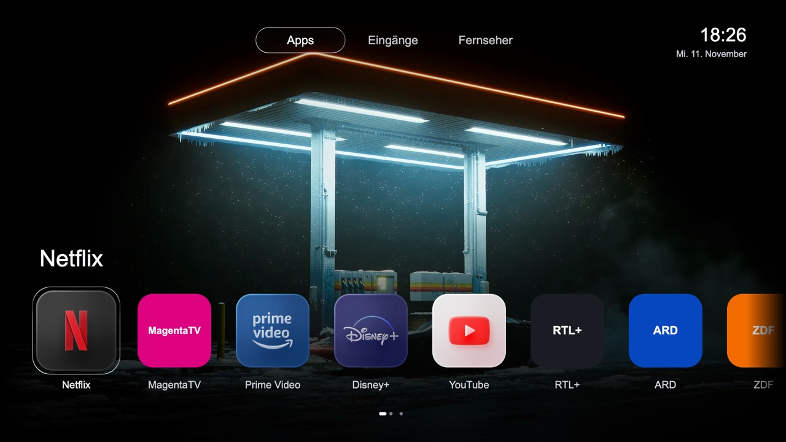

# Hisense VIDAA: eigener Homescreen statt Werbung

[English](README.md) · [Masterprompt für Claude und Codex](MASTERPROMPT.md) · [Einfache Anleitung](START-HERE.md)

Dieses Projekt erklärt Coding Agents, wie sie auf einem **kompatiblen Hisense
VIDAA-Fernseher** eine eigene native Startseite mit einem App-Dock einrichten.
Dazu gehören langes OK zum Verschieben/Ausblenden, Eingänge, TV-Einstellungen,
App Store und eigene animierte Hintergründe.

Die Vorschau zeigt das Referenzdesign. Die abgebildeten privaten Icons und das
Hintergrundvideo werden nicht als Dateien mitgeliefert. Standardmäßig werden
lokale TV-App-Icons oder Textkacheln genutzt.

## Einfach dem Coding Agent geben

Kopiere diesen Text in Claude Code oder Codex mit Terminal-Zugriff auf einen
Computer im selben Netzwerk wie dein Fernseher:

> Lies https://raw.githubusercontent.com/nineodernein/hisense-vidaa-clean-home/main/MASTERPROMPT.md und setze die Anleitung für meinen eigenen Hisense-VIDAA-TV um. Prüfe zuerst Modell, Firmware und Zugriff. Ich möchte den nativen Homescreen mit App-Dock. Sichere Originaldateien privat, ändere keine anderen Geräte und installiere nichts bei unpassendem Firmware-Hash.

Der Agent bekommt Quellcode und konkrete Prüfschritte. Er muss nicht noch einmal
das ganze Projekt erfinden. Ein normaler Chat ohne Zugriff auf deinen Computer
und dein Netzwerk kann den Fernseher trotzdem nicht selbst ändern.

## Was funktioniert?

Am Referenzgerät wurden native Home-Rückkehr, App-Start, App-Favoriten bearbeiten,
Eingänge sowie ein lokales Video in Schleife und der manuelle Video-Bildschirmschoner
bestätigt. Das ist ein **nativer Umbau**, keine Browser-Umleitung.

Der veröffentlichte, verallgemeinerte Build ist offline geprüft, aber nicht als
neue Version auf dem Referenz-TV installiert. Die gemeinsame Medienauswahl ist
vorbereitet und offline getestet. Ein automatischer Regenvideo-Bildschirmschoner
bei pausiertem Netflix ist **nicht fertig**. Der reale Zehn-Minuten-Test auf Home
steht ebenfalls aus.

## Kann ich animierte Hintergrundbilder hinzufügen?

Ja. Eigene Videos werden lokal zu stummen H.264-MP4-Dateien mit 1080p/24 fps
aufbereitet. Ein JPG dient als Lade-/Fehlerfallback. Überblendung und eine kurze
zyklische Fortsetzung verringern sichtbare Sprünge beim Wiederholen.
Anleitung: [Animierte Hintergründe und Bildschirmschoner](ANIMATED-WALLPAPERS.md).

## Kann ich VIDAA-Werbung entfernen?

Für Home-Banner und bestimmte Empfehlungskacheln gibt es einen separaten
[DNS-Weg](DNS.md), auch ohne Root. Er wirkt nur auf den konfigurierten Fernseher.
Das ist keine Garantie gegen jede Werbung oder jede Datenübertragung.
Werbung innerhalb von Streamingvideos wird dadurch nicht zuverlässig entfernt.

## Passt das auf jeden Hisense?

Nein. Hisense verkauft unterschiedliche Betriebssysteme und Firmwarefamilien.
Getestet wurde eine interne Modellkennung 43A53FEVS_0004 mit MTK9602,
VIDAA U9 und P0930. Die Verkaufsbezeichnung allein reicht nicht.
[Kompatibilität prüfen](COMPATIBILITY.md).

VIDAA wird auch bei ausgewählten Fernsehern von Toshiba, Loewe/We. by Loewe,
MEDION und weiteren Marken verwendet. Das bestätigt nur das Betriebssystem,
nicht unseren nativen Umbau. Die [Modell- und Markenübersicht mit Herstellerquellen](VIDAA-MODELS.md)
trennt diese Geräte von der tatsächlich getesteten Referenz. Für andere Modelle
ist die Funktion dieses Docks bislang nicht bestätigt.

## Herunterladen und aktivieren

1. Oben auf GitHub **Code → Download ZIP** wählen.
2. ZIP auf dem Computer entpacken.
3. Den Ordner in Codex oder Claude Code öffnen.
4. Den Masterprompt-Link einfügen.
5. Der Agent prüft das Gerät, erstellt Sicherungen und bereitet die passende
   Änderung vor. Nur bei passenden Voraussetzungen folgt ein begrenzter Test.
6. Dock, App → Home und Wiederherstellung prüfen; erst danach übernehmen.

Alle Details mit Rückweg stehen in [START-HERE.md](START-HERE.md).
Keine fremde TV-Firmware herunterladen und keine undokumentierten Service-
Menü-Werte übernehmen.

Design-Quelle: **[Libraries.dev](https://libraries.dev/)**, insbesondere Liquid
Metal / metal-fx. Auf dem TV wird der Effekt mit kleinen vorberechneten Bildern
dargestellt. [Weitere Credits und Lizenzen](CREDITS.md).
