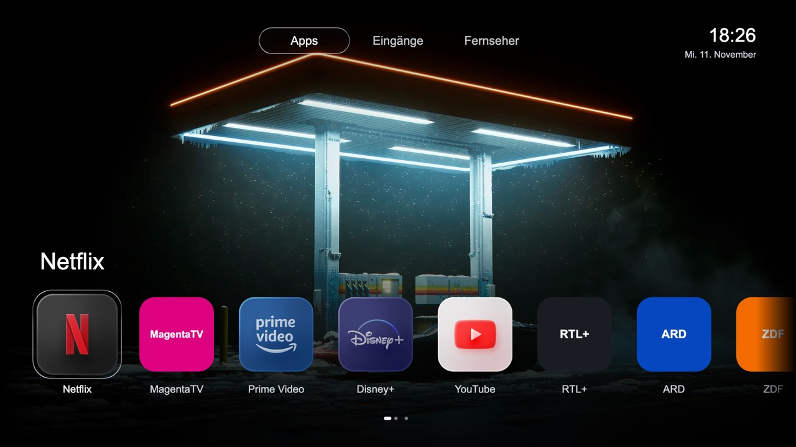

# Hisense VIDAA Clean Home
## Native app dock, custom home screen and animated wallpapers

[Deutsch](README.de.md) · [Start with your coding agent](AGENT-START.md) · [Download & setup](START-HERE.md) · [Compatibility](COMPATIBILITY.md) · [Offline simulation](SIMULATION.md) · [VIDAA brands & models](VIDAA-MODELS.md)

Replace the sponsored Hisense VIDAA home screen with a local, native app dock.
Keep your real installed apps, HDMI inputs and TV settings. Long-press OK to
reorder favorites or remove them from the home screen. Add your own animated
wallpapers and video screensavers.



*Example from the reference project. The screenshot is a design preview, not a
live screen capture. Its custom icon pack and wallpaper video are not bundled.
The default build uses the TV's cached icons or text tiles.*

### Give this to Claude Code or Codex

```text
Use this: https://github.com/nineodernein/hisense-vidaa-clean-home
```

The [agent instructions](AGENT-START.md) give a concrete goal and executable
workflow. They include [the successful techniques and failed approaches from
the original project](WORKED-EXAMPLE.md), plus [per-device porting](PORTING.md)
when another TV does not match the reference. A mismatch starts research and
adaptation; it is not automatically the end of the task.
The [access investigation playbook](ACCESS-RESEARCH.md) supplies concrete read
contracts, separate HiUtils/Fetcher routes and corrected false negatives. Agents
must keep an evidence ledger and pursue the next source-backed hypothesis when
one interface fails. Community observations remain separate from verified ports.

Give the repository link to Codex or Claude Code with a request to set it up for
your own TV. The agent should begin the local checks automatically. If it only
summarizes the link, paste this explicit instruction:

> Set up https://github.com/nineodernein/hisense-vidaa-clean-home for my own TV. Follow AGENT-START.md and MASTERPROMPT.md and run the offline checks now. Use ACCESS-RESEARCH.md to investigate missing access and pursue source-backed alternatives after a failed route. Reuse existing facts and permissions; keep backups private and verify recovery before native changes. Do not touch other devices.

The [agent entry point](AGENT-START.md) tells the agent what to execute and how to
handle each result. The [masterprompt](MASTERPROMPT.md) supplies the detailed
procedure. With Python 3.10+ and Node 18+ already available, the first command is:

```sh
python3 agent.py start --json
```

It checks the project, runs offline simulations and prepares blank private files.
It does not contact a TV or install software. The agent then collects missing
device evidence, prepares verified backups and a private build for review.
Use an agent with terminal access on your own computer; a remote web chat usually
cannot reach your TV. This is an
**agent-assisted recipe with source code**, not a universal one-click jailbreak.
An authorized maintenance channel and device-specific compatibility evidence
are prerequisites for native installation, not for beginning source research.
No promise of “a few minutes” on every model.

Two explicit native SDK adapters are included. The private port builder uses
the new device's own original Home and documented contract/recovery evidence;
it does not relax the reference hash guard. Neither adapter selection nor a
passing offline test establishes hardware support. Animated media on a new
firmware follows a successful static-Home trial and its own native-player review.

### What you get

- A **native VIDAA home component**, not a browser page reopened by a watcher.
- A horizontal app dock with soft edge fades and visible remote-control focus.
- Long OK: move a favorite or remove its tile. This does **not** uninstall the app.
- App Store pinned at the right, where supported by the model's app inventory.
- Apps, inputs and TV settings; normal up/down navigation in the input grid.
- Local MP4 wallpaper playback using the TV's native media player.
- A shared media catalog for background/saver selection; see status below.
- An optional, TV-scoped [DNS ad-blocking guide](DNS.md).
- [Libraries.dev](https://libraries.dev/) Liquid Metal design attribution.
  The TV uses pre-rendered metal-fx frames instead of running React/WebGL.

### Choose your route

| Want | Start here | Access |
| --- | --- | --- |
| Remove VIDAA home ads and recommendations | [DNS filtering](DNS.md) | A DNS filter; no TV root |
| Get the native dock and direct Home return | [Agent masterprompt](MASTERPROMPT.md) | Model-matched maintenance/root access |
| Add animated backgrounds | [Animated wallpapers](ANIMATED-WALLPAPERS.md) | A working native installation; your own clips |
| Understand a browser alternative | [Compatibility](COMPATIBILITY.md) | Broader availability, but Home may bounce through stock VIDAA |

### Tested honestly

**Does this work on every VIDAA TV? No.** VIDAA is also used on selected Toshiba,
Loewe/We. by Loewe, MEDION and other TVs, but using the same OS is not proof that
this native modification works. [Check the sourced brand/model directory](VIDAA-MODELS.md)
and the [project's actual test status](COMPATIBILITY.md) separately. Other Hisense
sets can run Google TV, Roku TV or Fire TV instead.

The original integration was verified on **one MTK9602 / VIDAA U9 / P0930 device**.
Native Home → app → Home, favorite editing, input navigation, a looping local
video and the manual Rainy-style saver/return from Home were confirmed.
The precise [profile and original-file hashes](compatibility.json) are included.

This public package has been generalized and tested offline. It has **not** been
installed as a new build on the reference TV. Shared on-screen media selection
was prepared and tested offline; it is not a confirmed deployed feature.
The ten-minute Home idle test is still open. A custom saver over **paused
Netflix is not implemented**. Do not claim otherwise or read Netflix memory.

### Does this debloat VIDAA or make every app ad-free?

It cleans the home interface and offers selective DNS filtering. It does not
remove VIDAA, uninstall every preinstalled package, replace the TV operating
system, or remove ads served inside YouTube/Netflix/other streaming content.
DNS filtering is not a complete privacy guarantee. ACR and microphone settings
are separate from launcher customization.

### Download, inspect, recover

Use **Code → Download ZIP**, extract it, then read [START-HERE.md](START-HERE.md).
The tools do not install dependencies, gain root, change DNS, or contact a TV
when you download or build. `build.mjs` refuses unknown original module hashes.
OEM bundles and device backups stay in `.private/` and must never be published.

Read [recovery](RECOVERY.md), [privacy](PRIVACY.md), [security](SECURITY.md) and
[credits/licenses](CREDITS.md) before a native trial.
For supported-model reports, use [CONTRIBUTING.md](CONTRIBUTING.md).

### Noncommercial use

New original maintainer contributions are available under
[PolyForm Noncommercial 1.0.0](LICENSE). Personal use and noncommercial hobby
customization are allowed; commercial use of those contributions requires
separate permission. [License scope](LICENSE-SCOPE.md) explains the retained
upstream MIT rights and earlier MIT releases. This is source-available for
noncommercial use, not a retroactive restriction on previously licensed code.

### Why this exists

VIDAA's stock home screen can be noisy, slow and difficult to personalize.
This project records the path from a browser workaround to a native component
inside the existing home engine, so another coding agent can start with the
working architecture instead of repeating the same dead ends.

Built on [alvidaa](https://github.com/carteakey/alvidaa), its native platform
adapter and the Free My TV design lineage. Independent community project;
not affiliated with Hisense, VIDAA, Netflix, Apple or Libraries.dev.
